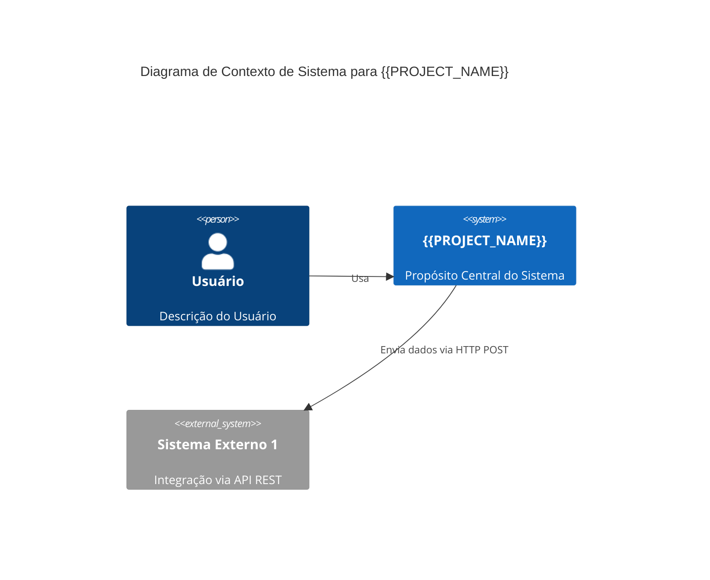
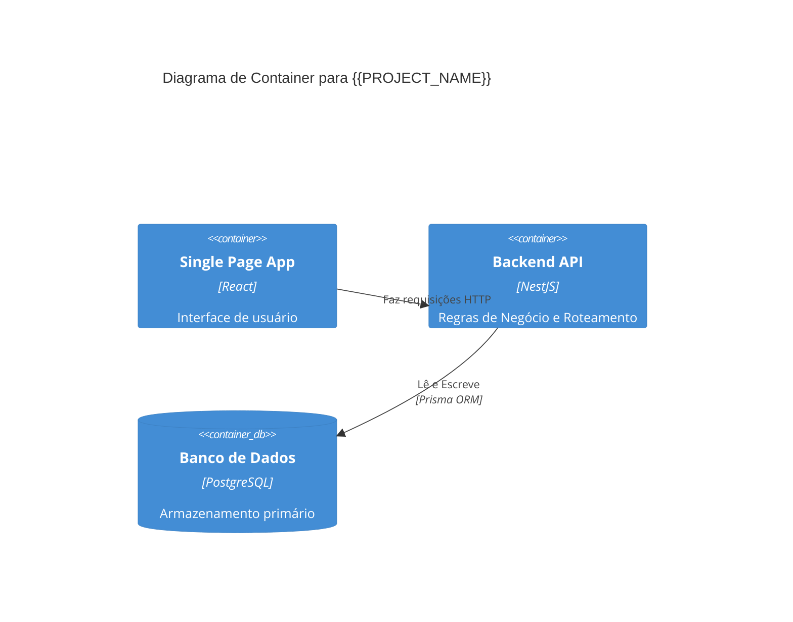

<!-- INSTRUÇÃO PARA O AGENTE: O arquivo 01-architecture documenta a topologia geral da aplicação, dependências externas e onde este sistema vive dentro da organização maior. O agente deve preencher com diagramas e tabelas estruturadas de integração. -->
# 01 - Arquitetura e Contexto C4: {{PROJECT_NAME}}

## 1. Diagrama de Contexto (Nível 1 - C4)
Crie um diagrama Mermaid (`mermaid`) ilustrando o usuário, nosso sistema, e os sistemas externos com quem ele interage.

## 2. Diagrama de Container (Nível 2 - C4)
Detalhe as peças estruturais que compõem este projeto (Ex: Web App, API Backend, Worker, Banco de Dados, Fila).

## 3. Integrações e Contratos Externos
Liste todos os serviços e componentes de terceiros dos quais nós dependemos para operar em produção, indicando sua criticidade (Alta/Média/Baixa).

| Dependência (Ex: API de Pagamento) | Tipo de Contrato (Ex: REST, gRPC) | Criticidade | Cenário de Fallback caso fora do ar |
|------------------------------------|-----------------------------------|-------------|---------------------------------------|
| -                                  | -                                 | -           | -                                     |
